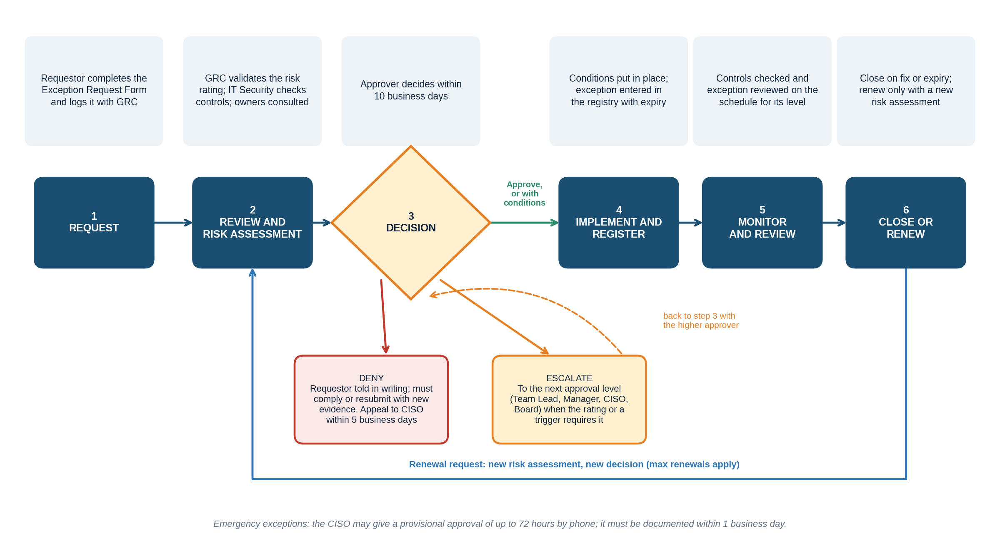
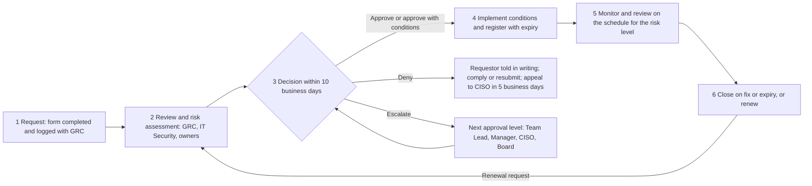

# NexusGuard Technologies Ltd. | Policy Exception Management Process | PRC-GRC-001

| Field | Detail |
|---|---|
| **Document Title** | Policy Exception Management Process |
| **Document ID** | PRC-GRC-001 |
| **Version** | 1.0 |
| **Classification** | Internal |
| **Author** | Augustine Ozor, GRC Analyst |
| **Owner** | Chief Information Security Officer (CISO) |
| **Approved By** | Executive Leadership Team (approval pending) |
| **Approval Date** | Pending (DD/MM/YYYY to be entered on approval) |
| **Effective Date** | Upon approval |
| **Next Review Date** | 12 months from approval date |
| **Applicable Regulations** | ISO/IEC 27001:2022, HIPAA, PCI DSS v4.0, NCA ECC |

# Version History

| Version | Date | Author | Changes |
|---|---|---|---|
| 0.1 | 17/10/2026 | Augustine Ozor, GRC Analyst | Initial draft. Replaces verbal and email exception approvals with a documented, risk-based process. Includes worked examples for three live requests (NexusHealth Pro MFA, Cairo data routing, Finance scanning freeze). |
| 1.0 | Pending | Executive Leadership Team | Approval and publication. |

# 1. Process Overview

## 1.1 Purpose

NexusGuard Technologies Ltd. ("NexusGuard") has 450 employees and operates under HIPAA, PCI DSS, ISO/IEC 27001 and the NCA Essential Cybersecurity Controls (ECC). Today, exceptions to security policies are granted verbally or by email, without documentation, risk assessment or management approval. That leaves audit and compliance exposure, because NexusGuard cannot show who accepted which risk, why, for how long, or whether the agreed safeguards were ever put in place.

This process gives every exception the same path: request, review, decision, monitoring and closure. It makes sure each exception is risk-assessed, approved at the right level, time-limited, supported by compensating controls, and recorded.

## 1.2 Scope

The process applies to all employees, contractors and third parties at NexusGuard in Dubai, Riyadh, Abu Dhabi and Cairo, to the NexusHealth Pro, NexusFinance Shield and PayStream Analytics products, and to every information security policy, standard and procedure. It covers requests to deviate from a requirement for a limited time. It does not cover permanent changes to policy, which go through the normal policy change process.

## 1.3 Policy Authority

The CISO owns this process under the Information Security Policy (clause 8, Exceptions). The Executive Leadership Team approves it, and the ISSC oversees its operation. Approval authority is delegated by the Approval Authority Matrix (Section 5) and cannot be varied by individual managers.

## 1.4 What an Exception Is

An **exception** is a formal, time-limited, risk-assessed and approved permission to depart from a stated requirement of a security policy, standard or procedure, with compensating controls to manage the added risk. It is not:

- an informal agreement, a verbal "go-ahead" or an email reply, none of which is a valid approval;
- a permanent change to policy (if the need lasts more than 12 months, the policy itself shall be reviewed);
- a way to do something that law, regulation or a client contract forbids; or
- a retrospective excuse. A deviation found after the fact is a policy violation, and may then be regularized only through this process, under the next level of scrutiny up.

## 1.5 Principles

- **Documented.** No exception exists unless it is on the form, approved, and in the registry.
- **Risk-based.** The approval level follows the risk, not the seniority of the requestor.
- **Time-limited.** Every exception has an end date and expires automatically.
- **Compensated.** Each exception has controls that reduce the added risk, with an owner and evidence.
- **Independent.** The approver is never the requestor, and GRC validates the risk rating.
- **Monitored and reported.** Active exceptions are reviewed on a schedule and reported to the ISSC.

## 1.6 Roles and Responsibilities

| Role | Responsibilities |
|---|---|
| Requestor | Completes the form, proposes compensating controls and a remediation plan, and puts the agreed controls in place. |
| Team Lead / Department Manager | Endorses the request, approves exceptions at the Low and Medium levels, and answers for the business risk. |
| IT Security Manager | Reviews technical feasibility and compensating controls, and checks they work. |
| GRC Analyst | Owns the registry; validates the risk rating and the approval level; sends expiry reminders; reports to the ISSC. |
| CISO | Owns the process; approves High exceptions; recommends Critical exceptions to the Board; can call in any exception. |
| Compliance Officer, DPO and Legal | Consulted where a regulation, personal data or a contract is involved. |
| Risk Committee / Executive Leadership | Receives quarterly exception reports; recommends Critical exceptions to the Board. |
| Board of Directors | Approves Critical exceptions. |
| Internal Audit | Tests the exception process and registry at least annually. |

# 2. Exception Lifecycle

Every exception passes through six steps. The five stages in the learning objectives (request, review, decision, monitor, closure) map to steps 1, 2, 3, 5 and 6. Step 4 covers putting the conditions in place and registering the exception.

## 2.1 Lifecycle Steps

| Step | What happens | Owner | Time limit | Output |
|---|---|---|---|---|
| 1 Request | The requestor completes the Exception Request Form (Section 3), including business justification, proposed controls and duration, and sends it to GRC. Verbal or email-only requests are not accepted. | Requestor | As needed | Completed form; exception ID |
| 2 Review and risk assessment | GRC checks the form is complete, tests the requestor's risk scoring, applies the escalation triggers and sets the risk level. IT Security checks the controls work. Compliance, DPO and Legal are consulted where triggered. | GRC Analyst; IT Security | 5 business days | Validated rating and approval level |
| 3 Decision | The approver for that level (Section 5) approves, approves with conditions, denies or escalates. Decisions are recorded on the form with reasons. | Approver | 10 business days from the request | Signed decision |
| 4 Implement and register | The requestor puts the conditions in place and IT Security confirms they are working. The exception starts only once this is confirmed. GRC enters it in the registry with start and expiry dates. | Requestor; IT Security; GRC | Before the start date | Evidence of controls; registry entry |
| 5 Monitor and review | Controls are checked and the exception is reviewed on the schedule for its level (Section 8). Any change in risk is reported at once. | Requestor; GRC | Per Section 8 | Review record |
| 6 Close or renew | The exception closes when the underlying fix is verified, or on expiry. A renewal needs a new request and risk assessment, and is limited as in Section 5. | GRC; approver | At expiry; reminders at 30, 14 and 7 days | Closure record or renewal decision |

**2.1** **Valid approval.** Only a signed Exception Request Form held in the registry is a valid approval. A verbal or email approval has no effect, and the activity remains a policy violation.

**2.2** **Emergency exceptions.** Where a delay would stop critical service, the CISO may give a provisional approval of up to 72 hours by phone. The requestor shall submit the form within 1 business day, and the exception lapses at 72 hours unless approved in full.

**2.3** **Segregation.** The approver shall not be the requestor or report to the requestor. GRC shall record any conflict and route the request to the next level.

**2.4** **Appeal.** A denied requestor may appeal once to the CISO within 5 business days. The CISO's decision is final, except that a Critical request goes to the Board.

# 3. Exception Request Form Template

The form below is completed for every request. GRC assigns the exception ID. A blank copy is also provided in the Markdown version of this document.

**Form FRM-EXC-001: Policy Exception Request**

### Section A: Requestor

| Field | Detail |
|---|---|
| **Exception ID (GRC)** | EXC-YYYY-NNN |
| **Requestor name and role** | [ ] |
| **Department, product and location** | [ ] (Dubai / Riyadh / Abu Dhabi / Cairo) |
| **Team Lead and Department Manager** | [ ] |
| **Date submitted** | [DD/MM/YYYY] |

### Section B: Policy reference

| Field | Detail |
|---|---|
| **Policy, standard or procedure** | [Title and ID] |
| **Clause and requirement** | [Clause number and wording of the requirement] |
| **Systems, data or processes affected** | [ ] |
| **Data classification and regulated data** | [Public / Internal / Confidential / Restricted]. PHI, cardholder data or personal data involved? [Yes / No] |

### Section C: Business justification

| Field | Detail |
|---|---|
| **Why the exception is needed** | [ ] |
| **Why the requirement cannot be met now** | [ ] |
| **Impact on the business if denied** | [ ] |
| **Alternatives considered** | [ ] |

### Section D: Risk assessment

| Field | Detail |
|---|---|
| **Threat** | [Who or what could exploit the gap] |
| **Vulnerability** | [The weakness the exception creates] |
| **Potential impact** | [Effect on confidentiality, integrity, availability, compliance, clients] |
| **Inherent risk (before controls)** | Likelihood [1-5] x Impact [1-5] = [score] ([Low / Medium / High / Critical]) |
| **Residual risk (with controls)** | Likelihood [1-5] x Impact [1-5] = [score] ([Low / Medium / High / Critical]) |
| **Escalation triggers (Section 4.3)** | [ ] Legal, regulatory or contractual requirement   [ ] Privileged access or authentication   [ ] PHI, cardholder or Restricted data   [ ] Logging, monitoring or encryption   [ ] Internet-facing production |

### Section E: Compensating controls

| # | Control | Owner | In place by | Evidence |
|---|---|---|---|---|
| 1 | [ ] | [ ] | [DD/MM] | [ ] |
| 2 | [ ] | [ ] | [DD/MM] | [ ] |
| 3 | [ ] | [ ] | [DD/MM] | [ ] |

### Section F: Requested duration and remediation

| Field | Detail |
|---|---|
| **Start and end date** | [DD/MM/YYYY] to [DD/MM/YYYY]. Maximum duration is set by the risk level (Section 5). |
| **Remediation plan and milestones** | [What will fix the underlying issue, who, and by when] |
| **Closure criteria** | [Evidence that will show the exception can close] |

### Section G: Approval chain

| Role | Name | Decision and conditions | Signature | Date |
|---|---|---|---|---|
| Requestor (declaration of accuracy) | [ ] | Submitted | [ ] | [ ] |
| Team Lead | [ ] | [Endorse / Approve (Low) / Decline] | [ ] | [ ] |
| Department Manager | [ ] | [Endorse / Approve (Medium) / Decline] | [ ] | [ ] |
| IT Security (technical review) | [ ] | [Controls adequate? Yes / No] | [ ] | [ ] |
| GRC Analyst (risk rating validated) | [ ] | [Rating and level confirmed] | [ ] | [ ] |
| Compliance, DPO, Legal (if triggered) | [ ] | [Consulted] | [ ] | [ ] |
| CISO (High) | [ ] | [Approve / Approve with conditions / Deny / Escalate] | [ ] | [ ] |
| Board (Critical) | [ ] | [Approve / Deny] | [ ] | [ ] |

### Section H: Registry (GRC use)

| Field | Detail |
|---|---|
| **Entered in registry by, and date** | [ ] |
| **Next review date** | [ ] |

# 4. Risk Classification Criteria

## 4.1 Scoring

**4.1** Each request is scored on a 5 x 5 scale. Likelihood is scored 1 (Rare) to 5 (Almost certain). Impact is scored 1 (Negligible) to 5 (Severe) using Table 1. The score is likelihood multiplied by impact.

**Table 1: Impact Scale**

| Score | Impact | Description |
|---|---|---|
| 1 | Negligible | No regulated data; no effect on clients or services; no compliance effect. |
| 2 | Minor | Internal data only; short internal disruption; minor internal policy breach. |
| 3 | Moderate | Confidential data at limited risk; internal service disruption; a compliance observation is possible. |
| 4 | Major | Restricted or regulated data at risk; client-facing disruption; breach of a client contract or regulatory requirement is possible. |
| 5 | Severe | Large-scale breach of PHI or cardholder data; regulator action; loss of certification or a major client. |

## 4.2 Risk Levels

**4.2** The risk level is set by the **residual** score (the score after the proposed compensating controls), subject to the escalation triggers in 4.3. The inherent score is recorded to show how much the controls reduce the risk, and GRC may reject controls that do not do so credibly.

**Table 2: Risk Levels**

| Level | Residual score | Typical criteria | Examples |
|---|---|---|---|
| Low | 1 to 4 | Internal data only; no regulated data; short duration; easily reversed. | Delay of a non-critical patch on an internal tool; a different tool for a non-sensitive task. |
| Medium | 5 to 9 | Confidential data or internal systems; limited exposure; effective compensating controls. | Rescheduling vulnerability scans for a business-critical freeze; delayed access review. |
| High | 10 to 16 | Restricted or regulated data, production systems or a regulatory or contractual requirement affected; compensating controls needed to bring risk down. | Admin accounts without MFA in a legacy system; data routed outside an approved region. |
| Critical | 17 to 25 | A serious exposure of PHI or cardholder data, or a breach of law, with weak or no compensating controls. | Production PHI stored unencrypted; disabling logging on cardholder systems. |

## 4.3 Escalation Triggers

**4.3** An exception that meets any trigger below shall be approved at **High level (CISO) at least**, whatever its residual score, and Compliance, the DPO or Legal shall be consulted as stated:

- it departs from a legal, regulatory or contractual requirement (Compliance Officer and Legal consulted);
- it concerns privileged access or authentication controls such as MFA (IT Security consulted);
- it involves PHI, cardholder data or other Restricted data, or personal data (DPO consulted);
- it switches off or weakens logging, monitoring or encryption; or
- it affects an internet-facing production system.

## 4.4 Exceptions Not Allowed

- to a requirement set by law, regulation or a client contract unless Legal confirms in writing that it is permitted (for example, PCI DSS mandatory controls can be met only by an approved compensating control);
- for longer than the maximum in Table 3, or renewed more often than the renewal limit; and
- that would remove all controls over Restricted data in production.

# 5. Approval Authority Matrix

**Table 3: Approval Authority by Risk Level**

| Level | Approver | Endorses | Consulted | Informed | Maximum duration and renewal |
|---|---|---|---|---|---|
| Low | Team Lead | Requestor | GRC (validates rating) | Department Manager | 12 months. Renewable once for 12 months. |
| Medium | Department Manager | Team Lead | IT Security, GRC, data owner | CISO (may call in within 5 business days) | 6 months. Renewable once for 6 months. |
| High | CISO | Department Manager | Compliance Officer, DPO, Legal, IT Operations (as triggered) | Risk Committee (quarterly report) | 90 days. Renewable once for up to 90 days; a further renewal is treated as Critical. |
| Critical | Board of Directors | CISO and Executive Leadership | Legal, DPO, Compliance Officer, Risk Committee | ISSC, Internal Audit; regulator or client where required | 30 days. Renewable only by the Board. |

**5.1** Approval authority follows the level and cannot be delegated down. A higher authority may always decide a lower-level exception.

**5.2** The CISO may call in any Low or Medium exception within 5 business days of being informed, and decide it as a High exception.

**5.3** GRC shall confirm the level before the request goes to the approver, and the approver shall record the rating on the form. An approver who disagrees with the rating shall escalate, not lower it.

**5.4** The Risk Committee shall receive a quarterly report of all High exceptions, and the Board shall be told of every Critical exception.

# 6. Exception Registry Template

GRC maintains one registry for all exceptions. A working Excel version (NexusGuard_Exception_Registry.xlsx) calculates days to expiry and status automatically. The three rows below are the worked examples in Section 7.

| Exception ID | Date logged | Requestor and department | Policy and clause | Description | Risk (inherent to residual) | Level and approver | Decision | Start | Expiry | Status | Next review | Closure owner and evidence |
|---|---|---|---|---|---|---|---|---|---|---|---|---|
| EXC-2026-001 | 17/10/2026 | NexusHealth Pro development team lead | Access Control Policy, clause 5.4.7 (MFA for admin accounts) | Admin accounts on legacy test environment without MFA for 90 days | High 12 to Medium 6 | High: CISO | Approved with conditions | 19/10/2026 | 17/01/2027 | Approved, starts 19/10/2026 | 02/11/2026 (then every 30 days) | Engineering Manager; MFA enforced and verified by IT Security |
| EXC-2026-002 | 17/10/2026 | Cairo office IT lead | Data residency requirement, POL-DCH-001 clause 5.8 | Cairo traffic routed through European servers; Internal and Confidential data only | High 12 to Medium 6 | High: CISO | Approved with conditions (partial) | 20/10/2026 | 18/01/2027 | Approved, starts 20/10/2026 | 04/11/2026 (then every 30 days) | Cairo IT lead; UAE-routed connectivity verified by IT Security |
| EXC-2026-003 | 17/10/2026 | Finance team lead | Vulnerability scanning policy (quarterly), ISP clause 5.9.2 | No scans during 60-day year-end freeze; scans before and after | Medium 9 to Medium 6 | Medium: Finance Manager | Approved with conditions | 01/12/2026 | 29/01/2027 | Approved, starts 01/12/2026 | 15/12/2026 | Finance Manager; post-freeze scan report |
| [ ] | [ ] | [ ] | [ ] | [ ] | [ ] | [ ] | [ ] | [ ] | [ ] | [ ] | [ ] | [ ] |

_Status values: Requested, Approved (not started), Active, Expiring (30 days or less), Expired, Renewed, Closed, Denied. An exception past its expiry date and not closed is shown as Expired and treated as a policy violation until closed or renewed._

# 7. Worked Examples

The three current situations are processed below exactly as the process requires. Each shows the completed request, the risk assessment, the decision and the compensating controls. The dates are illustrative, and the decisions show how the named approvers would decide under this process. Where a fact is assumed, it is stated and made a condition.

## 7.1 Situation A: NexusHealth Pro admin accounts without MFA

### Exception request (completed form)

| Field | Detail |
|---|---|
| **Exception ID** | EXC-2026-001 |
| **Requestor and department** | Development Team Lead, NexusHealth Pro (Product Teams). Endorsed by the Engineering Manager, NexusHealth Pro. |
| **Policy reference** | Access Control Policy (POL-ACC-001), clause 5.4.7: MFA required for all privileged accounts. |
| **Systems, data and classification** | Legacy NexusHealth Pro test environment: admin accounts for its servers and database. The environment holds masked test data only (no live PHI), to be confirmed by the DPO before the start date. Classification: Confidential. |
| **Business justification** | The legacy components cannot support MFA. The environment is needed to test NexusHealth Pro releases. The team needs 90 days to upgrade or replace the authentication components. |
| **Alternatives considered** | Shutting down the environment would stop release testing for a HIPAA-regulated product. Moving tests to production is not acceptable. Placing an MFA gateway in front of the environment is feasible and is proposed as the main control. |
| **Requested duration** | 90 days. |

### Risk assessment

| Element | Assessment |
|---|---|
| Threat | An attacker or malicious insider steals or guesses an admin password (phishing, password spraying, credential reuse) and signs in to the legacy test environment. |
| Vulnerability | Admin accounts rely on a password alone. Legacy components are unsupported and may share credentials or network paths with other environments. |
| Potential impact | Unauthorized admin access to the test environment; possible movement into production, or exposure of masked NexusHealth Pro data. A control gap against the HIPAA Security Rule and the Access Control Policy. |
| Inherent risk | Likelihood 3 (Possible) x Impact 4 (Major) = 12, High. |
| Residual risk (with controls) | Likelihood 2 (Unlikely) x Impact 3 (Moderate) = 6, Medium, once the conditions below are in place. |
| Escalation triggers met | Yes: privileged access and authentication (4.3). |
| Risk level and approver | Residual Medium, raised to High by the privileged-access trigger. Approver: CISO. Maximum 90 days. |

### Decision

| Field | Detail |
|---|---|
| **Decision** | APPROVED WITH CONDITIONS |
| **Approval period** | 19/10/2026 to 17/01/2027 (90 days). One renewal of up to 90 days may be requested only with a CISO-approved plan showing the upgrade is on track. |
| **Reasoning** | The need is real and time-bound, and the environment holds no live PHI. The risk to production is the main concern, so the approval depends on three things: MFA at the point of entry through a gateway, isolation from production, and strong vaulted credentials with close monitoring. Without these, the exception would be denied. |

### Compensating controls and conditions

| # | Control or condition | Owner | Evidence |
|---|---|---|---|
| 1 | Admin access only through an MFA-protected jump server. Direct access to the environment is blocked at the firewall. | IT Security Manager | Firewall rules; jump server configuration |
| 2 | Environment isolated from production: no routes to production networks; admin access limited to an allow-list of source addresses. | IT Operations Manager | Network diagram; rule export |
| 3 | Admin passwords at least 16 characters, unique, held in the PAM vault, and rotated every 30 days and after each use. No shared admin accounts. | IT Security Manager | PAM report |
| 4 | No live PHI or cardholder data in the environment. DPO confirms before the start date, and a data scan is run at day 1 and day 45. | Team Lead; DPO | DPO confirmation; scan reports |
| 5 | Admin sign-ins and commands sent to the SIEM. Alert on sign-ins outside business hours or from other addresses. Weekly review by Security Operations. | SOC Manager | SIEM rule; weekly review log |
| 6 | Named admins only (list kept by IT Security). Unused admin accounts removed before the start date. | Engineering Manager | Account list |
| 7 | Upgrade milestones: design by day 30, migration test by day 60, MFA enabled by day 85. Progress report to the CISO every two weeks. | Engineering Manager | Fortnightly reports |

### Monitoring, closure and approvals

Review every 30 days (first review 02/11/2026), with a closure-readiness check at day 80. The exception closes when IT Security verifies that MFA is enforced on every admin account. It expires automatically at day 90, and the CISO shall be told at day 60 if the milestones are late. If it expires without MFA, admin access to the environment is suspended.

| Role | Decision | Date |
|---|---|---|
| Development Team Lead (requestor) | Submitted 17/10/2026 | 17/10/2026 |
| Engineering Manager | Endorsed | 17/10/2026 |
| IT Security Manager | Controls adequate | 18/10/2026 |
| GRC Analyst | High level confirmed (privileged-access trigger) | 18/10/2026 |
| CISO | Approved with conditions | 19/10/2026 |

## 7.2 Situation B: Cairo office data routed through European servers

### Exception request (completed form)

| Field | Detail |
|---|---|
| **Exception ID** | EXC-2026-002 |
| **Requestor and department** | IT Lead, Cairo office. Endorsed by the Country Manager, Cairo. |
| **Policy reference** | Data residency requirement (data must reside in the UAE or GCC region): Data Classification and Handling Policy (POL-DCH-001), clause 5.8, and client contract terms. |
| **Systems, data and classification** | Network traffic from Cairo staff to NexusGuard systems, which local internet connectivity routes through European servers. Data at rest remains in the UAE. Classification of data affected: Internal and Confidential; the office may also reach Restricted systems (PHI, cardholder data) unless blocked. |
| **Business justification** | The local internet provider routes traffic via Europe, and no UAE or GCC route is currently available. Cairo staff cannot work without connectivity. |
| **Alternatives considered** | Closing the Cairo office connection is not practical. Other providers and private connectivity to Dubai are being quoted, but cannot be in place for several weeks. |
| **Requested duration** | Not stated by the requestor. GRC proposed 90 days, matching the maximum for a High exception. |

### Risk assessment

| Element | Assessment |
|---|---|
| Threat | Traffic is intercepted, inspected or cached in a non-approved jurisdiction; a foreign authority or provider gains access; NexusGuard breaches a residency commitment to a client. |
| Vulnerability | Traffic leaves the approved region on a path NexusGuard does not control. If unencrypted, or if any service caches data in Europe, residency is lost. |
| Potential impact | Breach of client contract or data residency expectations (including under NCA ECC and UAE data protection law); regulatory or contractual penalties; loss of client trust. Higher if PHI or cardholder data were involved. |
| Inherent risk | Likelihood 3 (Possible) x Impact 4 (Major) = 12, High. |
| Residual risk (with controls) | Likelihood 2 (Unlikely) x Impact 3 (Moderate) = 6, Medium, if traffic is encrypted end to end and Restricted data is blocked from Cairo. |
| Escalation triggers met | Yes: regulatory and contractual requirement; Restricted and personal data (4.3). |
| Risk level and approver | Residual Medium, raised to High by the regulatory and data triggers. Approver: CISO, with the DPO, Legal and the Compliance Officer consulted. Maximum 90 days. |

### Decision

| Field | Detail |
|---|---|
| **Decision** | APPROVED WITH CONDITIONS (PARTIAL) |
| **Approval period** | 20/10/2026 to 18/01/2027 (90 days). One renewal of up to 90 days if Legal and the DPO confirm and the connectivity project is on track. |
| **Reasoning** | Residency is about where data is stored and processed, and the risk here is transit through Europe. That can be reduced to an acceptable level by an always-on encrypted tunnel to a UAE gateway, no local data storage, and a block on Restricted systems. The exception is therefore granted for Internal and Confidential data only. **Access to PHI and cardholder data from Cairo is denied** under this exception, because that data would carry a High impact. Legal shall confirm that no client contract prohibits transit through Europe. |

### Compensating controls and conditions

| # | Control or condition | Owner | Evidence |
|---|---|---|---|
| 1 | All Cairo corporate traffic goes through an always-on encrypted tunnel (ZTNA or VPN, TLS 1.2 or IPsec) that ends at a UAE-hosted gateway. If the tunnel fails, traffic is blocked (no fallback to the open internet). | IT Security Manager | Tunnel configuration; kill-switch test |
| 2 | Cairo endpoints are managed with full-disk encryption. No NexusGuard data is stored locally, using browser isolation or virtual desktops. | IT Operations Manager | Endpoint compliance report |
| 3 | Conditional access blocks Cairo users and addresses from systems holding PHI and cardholder data. DLP blocks transfers of Restricted data. | IT Security Manager | Access policy export; DLP rule |
| 4 | Routing is checked monthly to confirm traffic ends in the UAE before reaching any third country. | Cairo IT Lead | Route test results |
| 5 | DPO and Legal confirm that no client contract prohibits transit through Europe. The transfer is recorded in the transfer register, and clients are told where the contract requires it. | DPO; Legal | DPO and Legal memo; transfer register entry |
| 6 | Tunnel logs go to the SIEM, with an alert if the tunnel is down or traffic bypasses it. | SOC Manager | SIEM rule |
| 7 | Remediation: UAE-routed connectivity (local provider with UAE peering, SD-WAN with a UAE point of presence, or private link) ordered by day 30 and live by day 75. | Cairo IT Lead | Order and go-live records |

### Monitoring, closure and approvals

Review every 30 days (first review 04/11/2026), with a mid-point check at day 45 on the connectivity order. The exception closes when UAE-routed connectivity is live and IT Security verifies the route. If it is not live by day 90 and no renewal is approved, Cairo access to NexusGuard systems is limited to approved offline work until it is.

| Role | Decision | Date |
|---|---|---|
| Cairo IT Lead (requestor) | Submitted 17/10/2026 | 17/10/2026 |
| Country Manager, Cairo | Endorsed | 17/10/2026 |
| IT Security Manager | Controls adequate | 19/10/2026 |
| DPO and Legal | Consulted; contract check required | 19/10/2026 |
| Compliance Officer | Consulted | 19/10/2026 |
| GRC Analyst | High level confirmed (regulatory and data triggers) | 19/10/2026 |
| CISO | Approved with conditions (partial) | 20/10/2026 |

## 7.3 Situation C: Finance quarterly vulnerability scanning during year-end freeze

### Exception request (completed form)

| Field | Detail |
|---|---|
| **Exception ID** | EXC-2026-003 |
| **Requestor and department** | Finance Team Lead. Approved by the Finance Manager. |
| **Policy reference** | Vulnerability scanning policy requiring quarterly scans: Information Security Policy (POL-ISP-001), clause 5.9.2. PCI DSS v4.0 Requirements 11.3.1 and 11.3.2 apply only if the system is in PCI scope. |
| **Systems, data and classification** | Finance ERP and reporting systems during the year-end close. Classification: Confidential (financial data). Assumption to confirm before approval: the Finance systems are not in PCI DSS scope. |
| **Business justification** | A 60-day year-end freeze (01/12/2026 to 29/01/2027) protects financial close and reporting. Scans, especially authenticated ones, can slow systems and cause disruption during the close. |
| **Alternatives considered** | Running scans as normal was rejected by Finance because of the performance risk. Lighter-touch scanning during the freeze and a full scan before and after it were considered and are adopted as the conditions. |
| **Requested duration** | 60 days (01/12/2026 to 29/01/2027). |

### Risk assessment

| Element | Assessment |
|---|---|
| Threat | A new vulnerability in a finance system is exploited (for example by ransomware or fraud) during the freeze and goes unseen. |
| Vulnerability | No full scan for 60 days, so new vulnerabilities and misconfigurations go undetected. The systems are internal and not internet-facing. |
| Potential impact | Possible compromise of financial data or reporting integrity at year-end, and an audit observation if the external auditors review vulnerability management. |
| Inherent risk | Likelihood 3 (Possible) x Impact 3 (Moderate) = 9, Medium. |
| Residual risk (with controls) | Likelihood 2 (Unlikely) x Impact 3 (Moderate) = 6, Medium, with the conditions in place. |
| Escalation triggers met | None, once Finance systems are confirmed outside PCI DSS scope. If they are in scope, the request is raised to High and the PCI scan intervals shall still be met. |
| Risk level and approver | Medium. Approver: Department Manager (Finance Manager), with IT Security consulted and the CISO informed. Maximum 6 months; 60 days requested. |

### Decision

| Field | Detail |
|---|---|
| **Decision** | APPROVED WITH CONDITIONS |
| **Approval period** | 01/12/2026 to 29/01/2027 (60 days). No renewal. The exception expires automatically, and the full scan resumes. |
| **Reasoning** | The business need is genuine and short, the systems are internal, and the real gap can be limited to the freeze period. The exception is not "no scanning". It moves the full scan to just before the freeze, keeps non-intrusive monitoring running during it, and requires a full scan soon after it ends. Together these keep the interval between full scans to about 10 weeks, inside a three-month window. |

### Compensating controls and conditions

| # | Control or condition | Owner | Evidence |
|---|---|---|---|
| 1 | Scope check: IT Security and the Compliance Officer confirm the Finance systems are outside PCI DSS scope. If not, raise the request to High before approval. | IT Security Manager; Compliance Officer | Scope confirmation memo |
| 2 | A full authenticated scan is completed before the freeze (between 16/11 and 27/11/2026), with Critical and High findings fixed or planned before 01/12/2026. | IT Security Manager; Finance IT | Scan report; remediation list |
| 3 | During the freeze: non-intrusive scanning continues (agent-based or passive discovery and an external attack-surface scan), plus EDR and network monitoring on the finance systems. | Security Operations | Weekly scan summary; SIEM alerts |
| 4 | Emergency patching stays available: any Critical vulnerability or one known to be exploited is fixed under an emergency change, with a targeted rescan afterwards. | IT Operations Manager | Emergency change records |
| 5 | A full authenticated scan is run within 10 business days after the freeze ends (by 12/02/2027), with findings triaged under the normal SLAs. | IT Security Manager | Scan report dated by 12/02/2027 |
| 6 | No new systems or major changes are added to the Finance environment during the freeze without a targeted scan. | Finance Manager | Change log |

### Monitoring, closure and approvals

Review at the mid-point of the freeze (15/12/2026) by GRC. The exception closes when the post-freeze scan report is received and its Critical and High findings are in the remediation plan. If the post-freeze scan is late, GRC reports it to the CISO and the Finance Manager loses the right to defer the next scan.

| Role | Decision | Date |
|---|---|---|
| Finance Team Lead (requestor) | Submitted 17/10/2026 | 17/10/2026 |
| IT Security Manager | Controls adequate; scope check in progress | 20/10/2026 |
| GRC Analyst | Medium level confirmed, no triggers | 20/10/2026 |
| Finance Manager | Approved with conditions | 21/10/2026 |
| CISO | Informed (call-in period to 28/10/2026) | 21/10/2026 |

# 8. Exception Review Schedule

**Table 4: Review Schedule by Risk Level**

| Level | Review frequency | Reviewer | What is checked | Expiry reminders |
|---|---|---|---|---|
| Low | Every 6 months and at expiry | GRC Analyst | Exception still needed; controls still in place | 30 and 7 days before expiry |
| Medium | Every 3 months and at expiry | GRC Analyst and Department Manager | Controls working; remediation progress; any change in risk | 30, 14 and 7 days |
| High | Every 30 days and at expiry | GRC Analyst and CISO delegate | Evidence of each control; milestones; new threats; any incident linked to the exception | 30, 14 and 7 days; CISO told at day 60 if late |
| Critical | Weekly and at expiry | CISO and Risk Committee Chair | Controls, residual risk, and Board decision conditions | 14 and 7 days; Board informed |

**8.1** **Reviews.** At each review, GRC shall check the evidence for every compensating control, confirm the exception is still needed, and record the result in the registry. If a control has failed, or the risk has risen, GRC shall tell the approver at once, and the approver shall suspend or escalate the exception.

**8.2** **Expiry.** An exception expires on its end date without any action. GRC shall send reminders as in Table 4. On expiry the requirement applies again, and the requestor shall comply or request a renewal before the end date.

**8.3** **Renewal.** A renewal needs a new request, a new risk assessment, and a decision at the level the new score requires. The renewal limits in Table 3 apply, and a request beyond them is treated as Critical or, if the need is lasting, as a case for changing the policy.

**8.4** **Closure.** An exception closes when the underlying issue is fixed. The requestor supplies evidence, IT Security verifies it, and GRC records the closure date and evidence in the registry. Compensating controls remain until closure is verified.

**8.5** **Expired or unapproved exceptions.** An activity that continues after expiry, or was never approved, is a policy violation. GRC shall report it to the CISO, and it is handled under the sanctions in the Acceptable Use Policy and the HR disciplinary procedure.

**8.6** **Reporting.** GRC shall report each quarter to the ISSC and the Risk Committee: exceptions by level, active, expiring and expired exceptions, renewals, denials and closures, and exceptions open longer than 12 months. The ISSC shall review any policy that attracts repeated exceptions to see if it should change.

**8.7** **Audit.** Internal Audit shall test the registry and a sample of exceptions at least annually, and registry records shall be kept for six years.

**Table 5: Process Measures**

| Measure | Target |
|---|---|
| Requests decided within 10 business days | 95% or more |
| Exceptions past expiry and not closed or renewed | 0 |
| Active exceptions with a current review | 100% |
| Exceptions with verified compensating controls | 100% |
| Average duration of active High exceptions | 90 days or less |

# 9. Alignment to Standards

| Standard | How this process aligns |
|---|---|
| ISO/IEC 27001:2022 | Clause 5.1 leadership and commitment; 5.2 information security policy; 5.3 roles, responsibilities and authorities (approval matrix); 6.1.2 and 6.1.3 risk assessment and treatment (exception risk assessment); 7.5 documented information (form, registry); 9.1 monitoring and measurement; 9.3 management review (quarterly reporting); 10.2 nonconformity and corrective action. Annex A 5.1 policies, 5.4 management responsibilities, 5.36 compliance with policies, rules and standards. |
| NCA ECC | Subdomain 1-3 cybersecurity policies and procedures (approved, implemented, reviewed); 1-4 roles and responsibilities; 1-5 cybersecurity risk management; 1-7 compliance with standards, laws and regulations; 1-8 periodic review and audit. |
| HIPAA | 164.308(a)(1)(ii)(A) and (B) risk analysis and risk management; 164.308(a)(8) evaluation; 164.316(b) documentation retained for six years. |
| PCI DSS v4.0 | Requirement 12.1 security policy; 12.4 compliance management; Appendices B and C (compensating controls and worksheet) used for any deviation from a PCI requirement. |

_Note on ISO/IEC 27001:2022 Clause 5.5: the standard's Clause 5 contains 5.1 to 5.3 only, so there is no Clause 5.5. The brief's reference is read as the leadership, policy and authority requirements in Clause 5 and the exception-related controls in Annex A (in ISO/IEC 27002:2022, control 5.5 is "Contact with authorities"). Standard references are paraphrased pointers; verify against the source text._

# 10. Related Documents and Review

Related documents: Information Security Policy (POL-ISP-001, clause 8); Access Control Policy (POL-ACC-001); Data Classification and Handling Policy (POL-DCH-001); Acceptable Use Policy (POL-AUP-001); ISSC and Risk Committee Charters (CHR-ISSC-001, CHR-RSK-001); Exception Registry (NexusGuard_Exception_Registry.xlsx). Document IDs are proposed identifiers; confirm them against the document register.

This process shall be reviewed annually or when significant changes occur. The CISO initiates the review, and shall also review it after any audit finding on exceptions and when a policy attracts repeated exceptions.
