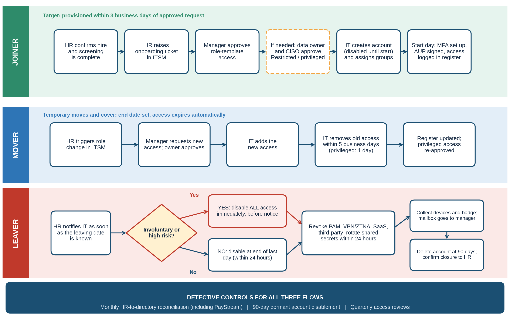
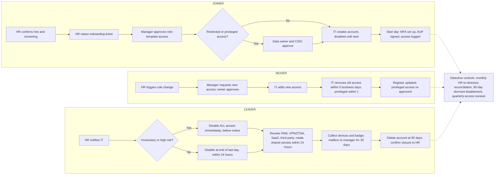

# NexusGuard Technologies Ltd. | User Access Provisioning Procedure | PRC-IAM-001

| Field | Detail |
|---|---|
| **Document Title** | User Access Provisioning Procedure (Joiner, Mover, Leaver SOP) |
| **Document ID** | PRC-IAM-001 |
| **Version** | 1.0 |
| **Classification** | Internal |
| **Author** | Augustine Ozor, GRC Analyst |
| **Owner** | Head of IT (Identity and Access Management) |
| **Approved By** | Chief Information Security Officer (approval pending) |
| **Approval Date** | Pending (DD/MM/YYYY to be entered on approval) |
| **Effective Date** | Upon approval of POL-ACC-001 |
| **Next Review Date** | 12 months from approval date |
| **Applicable Regulations** | ISO/IEC 27001:2022, HIPAA, PCI DSS v4.0, GDPR / UK GDPR, NIST CSF 2.0, UAE NESA |

# Version History

| Version | Date | Author | Changes |
|---|---|---|---|
| 0.1 | 12/10/2026 | Augustine Ozor, GRC Analyst | Initial draft supporting the Access Control Policy (POL-ACC-001). |
| 1.0 | Pending | CISO | Approved and published. |

# 1. Purpose

This procedure tells IT, HR, managers and system owners how to give, change and remove user access so that every joiner, mover and leaver is handled the same way, on time, and with evidence. It implements Sections 5.2, 5.3, 5.6 and 5.7 of the Access Control Policy (POL-ACC-001).

# 2. Scope

This procedure applies to all employees, contractors, temporary staff and third parties, and to all accounts on NexusGuard and PayStream Analytics systems, including Active Directory, Entra ID, Microsoft 365, AWS, SaaS, VPN, Zscaler and PAM.

# 3. Process Overview

# 4. Roles and Responsibilities

**HR** triggers every joiner, mover and leaver request. **Line managers** select and approve role-template access and recover assets. **System and data owners** approve access to their systems, and with the **CISO or delegate** approve Restricted, PHI and privileged access. **IAM (IT)** creates, changes and removes accounts, runs the monthly reconciliation and keeps the access register. **Security Operations** investigates any activity on orphan or former-staff accounts. **Sponsors** are accountable for third-party access.

# 5. Procedure

## 5.1 Joiner

| # | Action | Owner | Timing |
|---|---|---|---|
| J1 | Confirm the accepted offer or contract, completed screening and start date, and create the HR record. | HR | At least 7 business days before start |
| J2 | Raise the onboarding request in ITSM: name, role, department, manager, location, start date, employment type and, for contractors, end date. | HR | At least 5 business days before start |
| J3 | Select the role template, request any extra access with a reason, and approve. | Manager | Within 1 business day |
| J4 | Approve extra access and any access to PHI, cardholder data or Restricted systems. Privileged access follows 5.5. | Owner; CISO delegate | Within 2 business days |
| J5 | Check approvals match the template, then create the account disabled, add groups from the template, and set a unique initial credential. Never create shared accounts. | IAM | Within 3 business days of approval; before start date |
| J6 | Enable the account on the start date, deliver credentials securely, enroll two MFA methods and confirm device compliance. | IAM | Start date |
| J7 | Obtain the signed Acceptable Use Policy acknowledgment and awareness training. For PHI or cardholder data access, confirm role-based training first. Then record the access in the register and close the ticket. | HR; Manager; IAM | Before access is enabled |

## 5.2 Mover

| # | Action | Owner | Timing |
|---|---|---|---|
| M1 | Raise the role change request: new role, manager, location and effective date. For temporary moves, set an end date of no more than 90 days. | HR | At least 5 business days before effective date, where possible |
| M2 | Request access from the new role template, state what old access is no longer needed, and approve. | New manager | Within 1 business day |
| M3 | Approve extra, Restricted or privileged access. | Owner; CISO delegate | Within 2 business days |
| M4 | Add the new access on the effective date, not before. | IAM | Effective date |
| M5 | Compare current access with the new template and remove everything not in it. Remove standing privileged roles unless the system owner and CISO re-approve them. Record any approved exception with the owner's name. | IAM | Within 5 business days (privileged: 1 business day) |
| M6 | Update the register, confirm removal to the manager, and close the ticket. | IAM | Same day as M5 |

## 5.3 Leaver (standard)

| # | Action | Owner | Timing |
|---|---|---|---|
| L1 | Raise the leaver request with the leaving date and employment type as soon as the date is known. | HR | On notice |
| L2 | Confirm assets to recover, data and mailbox handover, shared secrets the leaver knows, and third-party systems they used. Name a delegate. | Manager | Within 2 business days |
| L3 | Disable the AD and Entra ID account, revoke sessions and tokens, remove MFA devices and group memberships, and disable VPN, Zscaler, PAM, AWS and SaaS access. | IAM | End of last working day; within 24 hours of termination date |
| L4 | Rotate shared secrets and privileged credentials the leaver knew, and revoke API keys, SSH keys and tokens. | IAM; Security | Within 24 hours |
| L5 | Recover laptop, phone, badge and tokens, and re-image the devices. Hand the mailbox to the manager for 30 days with an auto-reply, and block forwarding to external addresses. | Manager; IAM | Last working day |
| L6 | Delete the account after 90 days, archive data under the retention schedule, update the register and confirm closure to HR. | IAM | Day 90 |

## 5.4 Leaver (involuntary or high risk)

| # | Action | Owner | Timing |
|---|---|---|---|
| E1 | Alert IAM and Security before the meeting, and agree the exact time of notification. | HR; Legal | Before the person is informed |
| E2 | At or before notification, disable all accounts, revoke sessions and tokens, block VPN and Zscaler, suspend PAM, and disable the badge. Keep the mailbox and device untouched for investigation. | IAM; Security | Immediately |
| E3 | Review the last 30 days of logs for unusual access or data movement and escalate any finding under incident response. | Security | Same day |
| E4 | Collect devices and badge at the meeting, rotate shared secrets immediately, then continue with L5 and L6. | Manager; IAM | At the meeting |

## 5.5 Privileged access request

| # | Action | Owner | Timing |
|---|---|---|---|
| P1 | Raise a request in ITSM stating the system, privilege, reason and duration. | Requester | As needed |
| P2 | Approve the need and the lowest privilege level that will do. | System owner | Within 1 business day |
| P3 | Approve the request. | CISO or delegate | Within 1 business day |
| P4 | Grant a just-in-time role in PAM that expires after 8 hours at most. The user checks out credentials with MFA and the session is recorded. Standing roles need CISO approval and quarterly recertification. | IAM | On approval |

## 5.6 Contractor and third-party access

| # | Action | Owner | Timing |
|---|---|---|---|
| T1 | Request access: vendor, named individuals, systems, purpose, end date (maximum 90 days) and contract, NDA or BAA reference. | Sponsor | Before access is needed |
| T2 | Confirm a contract with security terms, and a BAA or data processing agreement where PHI or personal data is involved. | Legal; Procurement | Within 2 business days |
| T3 | Approve the access. | Owner; CISO delegate | Within 2 business days |
| T4 | Create named external accounts with MFA, connect through Zscaler Private Access or the vendor gateway, and use just-in-time access for privileged work. | IAM | Within 3 business days |
| T5 | Certify the access each quarter. Accounts disable automatically at expiry, and access is removed within 1 business day of contract end or vendor notice of staff leaving. | Sponsor; IAM | Quarterly; at expiry |

## 5.7 Monthly reconciliation and dormant accounts

| # | Action | Owner | Timing |
|---|---|---|---|
| R1 | Export accounts from Active Directory, Entra ID, AWS IAM, SaaS applications, VPN and Zscaler, PAM and PayStream directories. | IAM | First week of each month |
| R2 | Match every account to the HR roster, contractor register and third-party access register. | IAM | Within 3 business days |
| R3 | Disable accounts with no match and notify the likely owner. Log each one. | IAM | Within 2 business days of finding |
| R4 | Review any sign-in by an orphan or former-staff account as a possible incident. | Security | Same day as R3 |
| R5 | Disable accounts with no sign-in for 90 days (delete after 30 more days unless re-justified), and report orphans found and time to disable to the CISO. | IAM | Monthly |

# 6. Service Levels, Records and Review

Service levels are those in Table 2 of the Access Control Policy (for example joiners within 3 business days, standard leavers within 24 hours, involuntary leavers immediately). IAM shall report performance against them monthly.

For every event, IAM shall keep as evidence the ITSM ticket with its approvals, the time-stamped action log, entitlement reports, reconciliation reports and review certifications for at least six years, in the ITSM system and access register, and make them available to auditors. Deviations shall follow the Policy Exception Management Process, and no exception is permitted to the leaver deadlines or to MFA for privileged and remote access.

# 7. Related Documents

Access Control Policy (POL-ACC-001); Information Security Policy (POL-ISP-001); Acceptable Use Policy (POL-AUP-001); PAM Standard (STD-PAM-001). This procedure shall be reviewed annually or when significant changes occur. The Policy Owner initiates the review.
