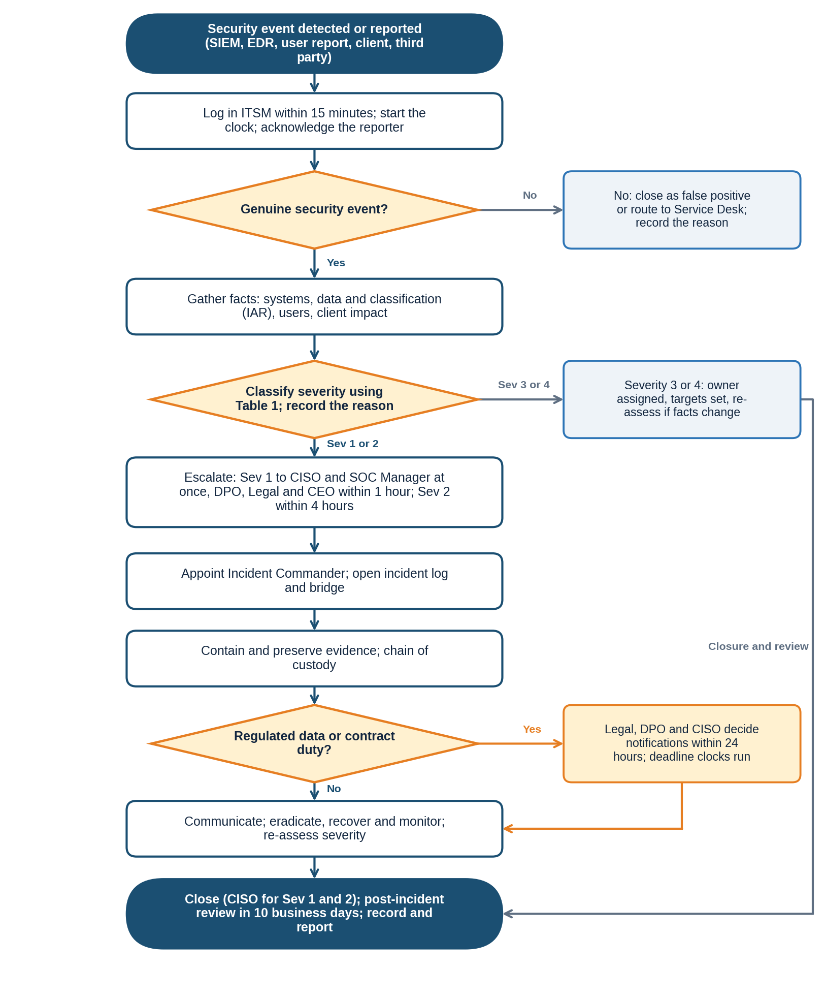

# NexusGuard Technologies Ltd. | Security Incident Classification and Escalation | SOP-B-001

# 1. Document Header

| Field | Detail |
|---|---|
| **SOP ID** | SOP-B-001 |
| **Title** | Security Incident Classification and Escalation |
| **Version** | 1.0 |
| **Effective Date** | Upon approval |
| **Owner** | Security Operations Center Manager, on behalf of the CISO |
| **Approved By** | Chief Information Security Officer (approval pending) |
| **Review Date** | 12 months from the effective date |
| **Classification** | Internal |
| **Author** | Augustine Ozor, GRC Analyst |

# 2. Purpose

This SOP makes sure that every reported security event is validated, classified in the same way each time, escalated to the right people within set times, and followed through to closure and learning. It exists so that operational staff know exactly what to do when something goes wrong, and so that auditors can see the process working.

It also makes sure legal and contractual notification duties (GDPR, HIPAA, PCI DSS and client contracts) are decided on time, because the clocks for these start when NexusGuard becomes aware of an incident, not when the investigation ends.

# 3. Scope

| Dimension | Coverage |
|---|---|
| Covers | All security events and incidents affecting NexusGuard information, systems, people or client data, including PayStream Analytics, from detection or report through classification, escalation, notification decision, closure and post-incident review. |
| People | All employees, contractors and third parties who may report an event, and the staff who triage and manage incidents. |
| Systems | SIEM, endpoint detection and response (EDR), the IT service management system (ITSM) and the incident register, email, cloud and on-premises systems. |
| Out of scope | Detailed technical containment steps for each incident type (held in the incident response playbooks) and IT faults with no security aspect (handled by the Service Desk). |

# 4. Definitions

| Term | Definition |
|---|---|
| Security event | An observed occurrence that may affect information security, such as an alert, a suspicious email or a lost device. |
| Security incident | One or more events that are confirmed or likely to harm the confidentiality, integrity or availability of information or services. |
| Severity | The rating (1 Critical to 4 Low) that sets response and escalation times. |
| Triage | The first check of an event to confirm it is real, and to gather enough facts to classify it. |
| Escalation | Passing an incident to a more senior or specialist person within a set time. |
| Incident Commander | The person who leads the response and makes decisions during a Severity 1 or 2 incident. |
| Regulated data | PHI, payment card data, special category personal data and other Restricted data under the Data Classification and Handling Policy. |
| Personal data breach | A breach of security leading to the accidental or unlawful destruction, loss, alteration, disclosure of, or access to, personal data. |
| Notification clock | The deadline for telling a regulator, client or other party, measured from the time NexusGuard became aware. |
| Chain of custody | The record of who held evidence and when, so it stays reliable for investigation or legal use. |
| Post-incident review (PIR) | A blameless review after closure that finds causes and improvements. |

# 5. Roles and Responsibilities

| Role | Responsibilities in this SOP |
|---|---|
| Any user | Reports a suspected event within 1 hour of discovery, using the Report Phishing button or the incident reporting channel. |
| Service Desk | Logs reports received by phone or ticket and passes security events to the SOC at once. |
| SOC Analyst | Logs, validates and classifies events; gathers facts; escalates; keeps the log. |
| SOC Manager | Owns this SOP; Incident Commander for Severity 2; checks classifications; reports metrics. |
| IT Security Manager | Provides technical lead and containment for security incidents. |
| CISO | Incident Commander for Severity 1; approves closure of Severity 1 and 2; accountable for the process. |
| DPO | Advises on personal data breaches and notification to data protection authorities and individuals. |
| Legal and Compliance Officer | Decide notification duties with the DPO and CISO; review external communications. |
| IT Operations Manager and System Administrators | Carry out containment, recovery and restoration. |
| Business Unit Lead | Business owner of affected systems; agrees service trade-offs during containment. |
| Communications and Executive Leadership | Draft and approve internal and external messages; the CEO is informed of Severity 1. |
| HR | Involved where an incident concerns staff conduct. |

# 6. Procedure Steps

## 6.1 Triggers and Inputs

- A SIEM or EDR alert that needs analyst review.
- A report from a user, client, supplier, regulator or law enforcement.
- A discovery during an audit, vulnerability scan or access review.
- A notification from a third party about an incident affecting NexusGuard data.

## 6.2 Severity Classification Rules

**Table 1: Severity Classification and Response Times**

| Severity | Criteria and examples | Triage | Escalation and updates |
|---|---|---|---|
| 1 Critical | Confirmed or suspected compromise of Restricted data (PHI, cardholder or special category data), or a major outage of client-facing services. Examples: ransomware on production, theft of patient data, compromise of the payment environment. | Within 1 hour | Phone the SOC Manager and CISO at once; DPO, Legal and CEO within 1 hour; updates every hour |
| 2 High | Compromise of Confidential data, a privileged account breach, active malware, or a significant service degradation. Examples: stolen admin credentials, malware on several devices, Confidential client data sent to the wrong recipient. | Within 2 hours | CISO and owners within 4 hours; updates every 4 hours |
| 3 Medium | A contained event with limited impact, or a policy violation with potential for harm. Examples: one phishing click with no credential entry, a lost encrypted laptop, unapproved software. | Within 1 business day | SOC Manager; resolution target 5 business days |
| 4 Low | A minor event with no evidence of harm. Examples: spam, a burst of failed logins, an information request. | Within 3 business days | Logged and tracked; resolution target 10 business days |

_Tie-breakers: apply the highest severity whose criteria are met. Any event involving regulated data is at least Severity 2 until the DPO confirms otherwise. If the facts are unclear, choose the higher severity and review within 4 hours._

**Table 2: Notification Clocks**

| Regime | Trigger | Clock |
|---|---|---|
| GDPR and UK GDPR | Personal data breach likely to risk individuals | Controller: 72 hours from becoming aware. Processor: without undue delay to the controller. |
| HIPAA | Breach of unsecured PHI | Business associate to covered entity: without unreasonable delay and no later than 60 days from discovery, or sooner as the BAA states. |
| PCI DSS | Suspected or confirmed compromise of account data | Immediately, as set by the acquirer and card brand rules. |
| Client contracts and local law | As the contract or the law states | As stated; Legal records the deadline in the notification log. |

## 6.3 Procedure

Follow the steps in order. Decision points are in the fourth column and in the diagram in Section 7.

| # | Step and action | Role | Decision or condition | Record or output |
|---|---|---|---|---|
| 1 | Receive the report or alert from any source. Create an ITSM ticket within 15 minutes with a unique ID, the time of detection, the time of report, the source and a short description. The clock starts at the earlier of detection and report. | Any user; SOC Analyst; Service Desk | None | Incident ticket with ID and times |
| 2 | Acknowledge the reporter (within 15 minutes if Severity 1 or 2 is suspected, otherwise within 1 hour). Check whether the event is a genuine security event. | SOC Analyst | False positive or IT fault: close with the reason or route to the Service Desk. Genuine: continue. | Acknowledgment; validation note |
| 3 | Gather the initial facts using the checklist: affected systems and accounts, data types and classification (look up the asset in the Information Asset Register), number of users affected, client or PayStream involvement, and whether the activity is still going on. Timebox to 15 minutes for suspected Severity 1 or 2. | SOC Analyst | None | Completed fact sheet |
| 4 | Classify the severity using Table 1 within 30 minutes of starting triage. Apply the tie-breakers. Enter the reason in the mandatory rationale field. | SOC Analyst; SOC Manager checks | Severity 1 or 2: go to step 6. Severity 3 or 4: go to step 5. | Severity and rationale in ticket |
| 5 | Handle Severity 3 and 4: assign an owner in IT or Security, set the due date (5 or 10 business days), keep the reporter informed, and re-assess if new facts appear. When fixed, go to step 13. | SOC Analyst; IT owner | New facts raise the severity: return to step 4 | Owner, due date, updates |
| 6 | Escalate Severity 1 and 2. Severity 1: phone the SOC Manager and CISO at once, and notify the DPO, Legal and the CEO within 1 hour. Severity 2: notify the CISO and the owners of the affected systems within 4 hours. Use the on-call phone list, not email alone. Record the time of each call. | SOC Analyst; SOC Manager | If a named person cannot be reached in 15 minutes, call the next on the on-call list | Escalation times in ticket |
| 7 | Appoint the Incident Commander (the CISO or delegate for Severity 1; the SOC Manager for Severity 2). Open the incident bridge and the incident log. Assign a technical lead, a communications lead, a scribe and a Legal and DPO liaison. | CISO; SOC Manager | None | Roles named in the incident log |
| 8 | Contain the incident using the playbook (isolate hosts, disable accounts, revoke tokens, block addresses). Preserve evidence: forensic images, logs and a chain-of-custody record. Do not power off or wipe a system without the CISO's approval. | IT Security Manager; System Administrators | Containment would stop a client service: the Incident Commander and Business Unit Lead agree the trade-off and record it | Containment actions; evidence record |
| 9 | Decide notification duties within 24 hours of the incident being confirmed. Start the deadline clock from the time of awareness for each regime in Table 2. Record the decision and its reasons, including a decision not to notify. | Legal; DPO; CISO | Regulated data or a contract duty: notify as required. Otherwise record the reasons. | Notification log with deadlines |
| 10 | Give status updates (Severity 1 hourly, Severity 2 every 4 hours) to the CISO and Executive Leadership. Communications drafts messages to staff, clients or regulators, and Legal and the DPO approve them. Use one spokesperson. | Incident Commander; Communications | External message: Legal approval first | Updates and approved messages |
| 11 | Eradicate the cause (malware, rogue accounts, vulnerabilities), restore from clean backups, and confirm with IT Security. Monitor for 72 hours (Severity 1) or 48 hours (Severity 2) for any return. | IT Security Manager; System Administrators | Recurrence: return to step 8 | Recovery and monitoring record |
| 12 | Re-assess the severity at each major update and at least every 4 hours for Severity 1 and 2. Raise it at once if the facts require. Lower it only with the Incident Commander's approval (and the CISO's for Severity 1 or 2). Record the reason. | Incident Commander | Change of severity: repeat the escalation in step 6 | Severity history |
| 13 | Close the incident when the closure checklist is complete: contained, eradicated, recovered, notifications done, evidence stored, business owner agrees, ticket complete. The CISO approves closure of Severity 1 and 2, and the SOC Manager Severity 3 and 4. | CISO; SOC Manager | Checklist item missing: keep open | Closure approval |
| 14 | Hold a blameless post-incident review within 10 business days of closing a Severity 1 or 2 incident (and for repeated Severity 3 patterns). Cover the timeline, root cause, what worked, and gaps. Agree actions with owners and dates, and update playbooks, controls and awareness material. Present the results to the ISSC. | CISO; SOC Manager; GRC Analyst | Actions overdue: report to the ISSC | PIR report; actions in the findings register |
| 15 | Update the incident register and metrics (time to triage, escalate and contain; notifications on time). Report monthly to the ISSC and review trends each quarter. Keep records for six years. | SOC Manager; GRC Analyst | None | Register entry; monthly report |

# 7. Process Flow Diagram

_The diagram follows steps 1 to 15. Decision points: whether the event is genuine (step 2), the severity (step 4), whether regulated data or a contract duty applies (step 9), and the closure checklist (step 13)._

# 8. Exception Handling

Where the normal procedure cannot be followed, use the fallback below, tell the process owner, and record the deviation in the ticket. Deviations are reviewed with the process results. A lasting deviation from a policy requirement is not an operational exception: it needs a formal exception through the Policy Exception Management Process (PRC-GRC-001).

| Situation | What to do |
|---|---|
| SIEM, EDR or ITSM is unavailable | Log the incident on the shared incident form, use the on-call phone list, and copy it into ITSM within 4 hours of recovery. |
| The incident involves the CISO, the SOC or a senior leader | Raise it to the Head of Compliance and Legal, who appoint an independent lead. The conflicted person does not take part in decisions. |
| Out of hours | The on-call SOC Analyst follows the same steps. Severity 1 triggers the phone tree at any hour. |
| Severity is unclear | Classify higher and review within 4 hours. |
| The incident is at a supplier or cloud provider | Follow the supplier's notification clause, record the supplier's timeline, and classify on the effect on NexusGuard and clients. |
| Request from a regulator or law enforcement | Pass it to Legal, who manage all contact. Staff do not respond directly. |
| PayStream systems not yet integrated | Use the same severity scale. The PayStream IT lead acts as technical lead and reports to the Incident Commander. |
| Several incidents at once | The CISO sets the order by severity and assigns separate commanders. |

# 9. Related Documents

| Document | ID | Relationship |
|---|---|---|
| Information Security Policy (clause 5.12) | POL-ISP-001 | Parent policy; severity table and notification rules |
| Incident Response Policy and Plan | POL-IRP-001 | Sets the plan and playbooks used in steps 8 and 11 |
| Acceptable Use Policy (clause 5.11) | POL-AUP-001 | User duty to report within 1 hour |
| Data Classification and Handling Policy | POL-DCH-001 | Defines regulated and Restricted data |
| Access Control Policy (logging clause 5.8) | POL-ACC-001 | Source of access alerts |
| Policy Exception Management Process | PRC-GRC-001 | Formal exceptions to policy |
| SOP-C Vulnerability Scanning and Patch Management | SOP-C-001 | Exploited vulnerabilities become incidents |
| Forms and templates: incident ticket, fact sheet, notification log, chain-of-custody form, PIR report | To be issued | Used in steps 1, 3, 8, 9 and 14 |

_Document IDs are proposed identifiers under the policy framework. Confirm them against the document register._

# 10. ISO/IEC 27001:2022 Control Mapping

| Control | Title | How this SOP satisfies it |
|---|---|---|
| A.5.24 | Information security incident management planning and preparation | Defined roles, severity scale, escalation times and playbook use (steps 4 to 8). |
| A.5.25 | Assessment and decision on information security events | Validation and classification rules with tie-breakers (steps 2 to 4). |
| A.5.26 | Response to information security incidents | Escalation, containment, eradication and recovery steps with named roles and times (steps 6 to 11). |
| A.5.27 | Learning from information security incidents | Blameless post-incident review, actions and playbook updates (steps 14 and 15). |
| A.5.28 | Collection of evidence | Evidence preservation and chain of custody (step 8). |
| A.6.8 | Information security event reporting | Reporting within 1 hour and ticket logging (step 1). |
| A.5.5 and A.5.31 | Contact with authorities; legal, statutory, regulatory and contractual requirements | Notification decisions and clocks (step 9, Table 2). |
| A.8.15 and A.8.16 | Logging; monitoring activities | SIEM and EDR alerts as triggers (step 1). |

_Control references are to Annex A of ISO/IEC 27001:2022. They are paraphrased pointers; verify them against the source text._

# 11. Document History

| Version | Date | Author | Change | Approved by |
|---|---|---|---|---|
| 0.1 | 19/10/2026 | Augustine Ozor, GRC Analyst | First draft for the ISO 27001:2022 certification audit evidence pack | n/a |
| 1.0 | Pending | Augustine Ozor, GRC Analyst | Approved and issued | CISO (pending) |
