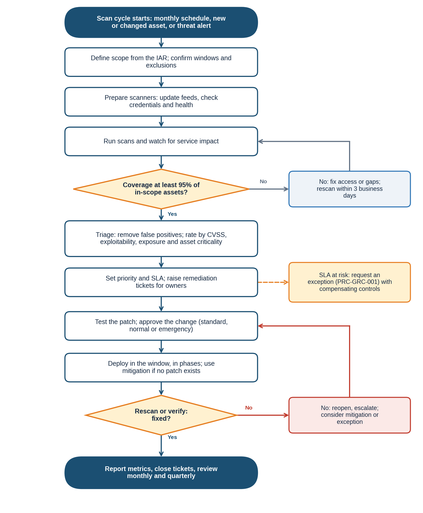

# NexusGuard Technologies Ltd. | Vulnerability Scanning and Patch Management | SOP-C-001

# 1. Document Header

| Field | Detail |
|---|---|
| **SOP ID** | SOP-C-001 |
| **Title** | Vulnerability Scanning and Patch Management |
| **Version** | 1.0 |
| **Effective Date** | Upon approval |
| **Owner** | IT Security Manager, on behalf of the CISO |
| **Approved By** | Chief Information Security Officer (approval pending) |
| **Review Date** | 12 months from the effective date |
| **Classification** | Internal |
| **Author** | Augustine Ozor, GRC Analyst |

# 2. Purpose

This SOP sets out how NexusGuard finds technical vulnerabilities, ranks them, fixes them within set times, and proves they are fixed. It exists so that scanning and patching are done the same way every cycle, by named people, and with evidence for auditors.

It supports the Information Security Policy requirements for monthly authenticated scanning and for fixing Critical vulnerabilities within 7 days, High within 30 and Medium within 90.

# 3. Scope

| Dimension | Coverage |
|---|---|
| Covers | Scanning, prioritization, change approval, deployment, verification, exceptions and reporting for vulnerabilities in NexusGuard and PayStream systems. |
| Systems | Servers, endpoints, network and security devices, databases, cloud workloads and accounts, containers and images, web applications and APIs, and third-party software that NexusGuard operates. |
| People | IT Security, IT Operations, system administrators, developers, business owners and the CISO. |
| Out of scope | Software-as-a-service vulnerabilities that only the provider can fix (covered by supplier management, SOP-D), and penetration test planning (follows this SOP for the fix process only). |

# 4. Definitions

| Term | Definition |
|---|---|
| Vulnerability | A weakness in a system that can be exploited to harm confidentiality, integrity or availability. |
| CVSS | The Common Vulnerability Scoring System, which rates severity from 0 to 10. |
| Known exploited vulnerability | A vulnerability listed in a trusted catalogue (for example the CISA Known Exploited Vulnerabilities list) as being used in attacks. |
| Authenticated scan | A scan that signs in to the system to see missing patches and settings that an outside scan cannot see. |
| ASV scan | An external scan by a PCI-approved scanning vendor, needed each quarter where PCI DSS applies. |
| Patch | A software update that fixes a vulnerability or fault. |
| Virtual patching or mitigation | A temporary control, such as a firewall or web application rule, that blocks exploitation when no patch is available. |
| Change types | Standard (pre-approved, routine), normal (reviewed by the change board) and emergency (urgent, approved by the CISO and reviewed afterwards). |
| SLA | The maximum time allowed to fix a vulnerability, set by its priority. |
| False positive | A reported finding that is not a real vulnerability. |
| Compensating control | A control that reduces the risk of a vulnerability that cannot be fixed on time. |

# 5. Roles and Responsibilities

| Role | Responsibilities in this SOP |
|---|---|
| IT Security Manager | Owns this SOP; runs the scanning program; approves scan scope and priorities; reports results. |
| Vulnerability analyst (IT Security team) | Prepares and runs scans, validates and triages findings, raises tickets and verifies fixes. |
| System Administrators | Test and deploy patches, apply mitigations and confirm service health. |
| IT Operations Manager | Schedules maintenance windows and manages the change process with the change board. |
| Business Unit Lead | Agrees downtime windows, and accepts or escalates risk for systems they own. |
| Developers and Engineering lead | Fix vulnerabilities in code, containers and dependencies. |
| CISO | Approves emergency changes, exceptions for High and Critical vulnerabilities, and reductions in priority of Critical items. |
| GRC Analyst | Compiles metrics and reports to the ISSC; checks evidence for audits. |
| Procurement and vendors | Supply vendor patches and security advisories for third-party software. |

# 6. Procedure Steps

## 6.1 Triggers and Inputs

- The monthly scan schedule (see Table 3).
- A new or changed system, before it goes live.
- A threat alert or advisory for an exploited vulnerability that may affect NexusGuard.
- A vendor patch release, including the monthly operating system update cycle.
- A penetration test, audit or incident finding that identifies a vulnerability.

## 6.2 Scanning Schedule and Priority Rules

**Table 3: Scanning Schedule**

| Scan type | Scope | Frequency | Owner |
|---|---|---|---|
| Internal authenticated scan | Servers, endpoints, network devices, databases | Monthly and after major change | IT Security |
| External scan | Internet-facing systems | Monthly; quarterly ASV scan where PCI DSS applies | IT Security |
| Web application and API testing | Customer-facing applications | Each major release and at least quarterly | Engineering; IT Security |
| Cloud posture and configuration | Cloud accounts and workloads | Continuous, reviewed weekly | IT Security; Cloud Operations |
| Container and dependency scanning | Code and images in the build pipeline | Every build | Engineering |
| Penetration test | Key systems and applications | At least annually and after significant change | CISO |

**Table 4: Priority and Fix Times**

| Priority | Base rule | Fix within | Notes |
|---|---|---|---|
| P1 Critical | CVSS 9.0 to 10, or any known exploited vulnerability | 7 days (known exploited: 72 hours, emergency change) | CISO is told on discovery |
| P2 High | CVSS 7.0 to 8.9 | 30 days | Weekly progress check |
| P3 Medium | CVSS 4.0 to 6.9 | 90 days | Include in the monthly patch cycle |
| P4 Low | CVSS below 4.0 | 180 days or next planned maintenance | May be accepted with owner approval |

_Adjust the base priority by context. Raise it one level if the system is internet-facing, holds Restricted data, is in production, or has a public exploit. Lower it one level only with a verified compensating control, and the CISO must approve any reduction of a Critical item. Fix times run from the date of detection._

**Table 5: Monthly Patch Cycle**

| Day after vendor release | Activity |
|---|---|
| 0 to 7 | Vendor patch reviewed and tested in staging; change raised |
| 7 | Pilot group (IT and volunteers) patched |
| 14 | Remaining endpoints patched |
| By 30 | Production servers patched in approved windows (P1 and P2 earlier, per Table 4) |

## 6.3 Procedure

Follow the steps for each scan cycle. Steps 6 to 10 repeat for each finding or group of findings.

| # | Step and action | Role | Decision or condition | Record or output |
|---|---|---|---|---|
| 1 | Confirm the scan scope from the Information Asset Register and the cloud inventory. Add new assets, remove retired ones, and note owners and classification. Record agreed exclusions and who approved them. | Vulnerability analyst | Asset missing from the IAR: add it or raise it with the IT Operations Manager | Scope list |
| 2 | Plan the schedule using Table 3. Agree scanning windows with the IT Operations Manager and Business Unit Leads and tell stakeholders at least 3 business days ahead. Scan new or changed systems before go-live. | IT Security Manager | A freeze period applies: request an exception (Section 8) | Schedule and notice |
| 3 | Prepare the scanners: update vulnerability feeds, check scanner health, confirm scan accounts (held in the PAM vault with least privilege) and firewall allowances. | Vulnerability analyst | Scanner or credential fault: fix before scanning | Scanner health check |
| 4 | Run the scans in the agreed window and monitor for impact on services. Record start and end times. | Vulnerability analyst | Service impact: pause the scan, inform the owner and reschedule | Scan logs |
| 5 | Check coverage: at least 95% of in-scope assets scanned, with authentication successful. Investigate gaps and rescan within 3 business days. | Vulnerability analyst | Coverage under 95%: fix access or gaps and rerun | Coverage report |
| 6 | Triage the findings: remove false positives (record the evidence), group duplicates, and rate each finding using the CVSS score, exploit information, exposure and asset criticality from the IAR. | Vulnerability analyst | Unclear risk: ask the asset owner or IT Security Manager | Triaged list |
| 7 | Set the priority and fix date from Table 4. Raise a remediation ticket in ITSM for each owner with the finding, affected assets, fix and due date. Share the report with Business Unit Leads. | Vulnerability analyst; System Administrators | SLA cannot be met: go to step 11 (exception) | Tickets with due dates |
| 8 | Test the patch in staging (or on the pilot group) and approve the change: standard for routine patches, normal for others, emergency for P1 with CISO approval. Write a back-out plan. | System Administrators; IT Operations Manager; CISO | Test fails: do not deploy; use a mitigation and update the ticket | Test result; change record |
| 9 | Deploy through the approved tools in the maintenance window, in phases (pilot, wider rollout, production). Where no patch exists, apply a mitigation (rule, setting, isolation) and record it. Confirm service health after each phase. | System Administrators | Service fault after patching: roll back and raise an incident | Deployment record; mitigation record |
| 10 | Verify the fix by rescan or direct check within 5 business days (immediately for P1). Update the ticket with evidence. | Vulnerability analyst | Still present: reopen the ticket and escalate to the IT Operations Manager | Verification scan; closed ticket |
| 11 | Handle delays: if a fix cannot be made on time, raise an exception under PRC-GRC-001 with compensating controls and a new date. The CISO approves exceptions for High and Critical items. Track each exception to closure. | IT Security Manager; CISO | End-of-life software: plan retirement and isolate it | Exception record |
| 12 | Report each month: scan coverage, mean time to patch Critical vulnerabilities, share fixed within SLA, overdue items by age, and repeat findings. Send to the ISSC and include in the GRC KPI dashboard. | GRC Analyst; IT Security Manager | Metric red: owner presents a recovery plan | Monthly report |
| 13 | Review each month with IT Operations, and each quarter review the scope, schedule and priority rules. Add scans when threat alerts or advisories show a new exposure (check exposure within 24 hours of an alert for a known exploited vulnerability). | IT Security Manager; IT Operations Manager | None | Review minutes; updated scope |
| 14 | Keep scan reports, tickets, change records and exception records for at least six years, and make them available to auditors on request. | IT Security Manager | None | Evidence folder |

# 7. Process Flow Diagram

_The diagram follows steps 1 to 14. Decision points: scan coverage (step 5), whether the SLA can be met (step 7, shown as the exception branch) and whether the fix is verified (step 10)._

# 8. Exception Handling

Where the normal procedure cannot be followed, use the fallback below, tell the process owner, and record the deviation in the ticket. Deviations are reviewed with the process results. A lasting deviation from a policy requirement is not an operational exception: it needs a formal exception through the Policy Exception Management Process (PRC-GRC-001).

| Situation | What to do |
|---|---|
| Scanner outage or credential failure | Use a backup scanner or agent data, record the gap, and rescan within 3 business days. |
| Scan would risk a critical service | Use a lighter scan (unauthenticated or passive) and agree a safe window with the Business Unit Lead. A full scan follows as soon as it is safe. |
| Business freeze or blackout period | Request an exception with compensating controls (for example a scan just before and after the freeze, and monitoring in between). |
| No vendor patch is available | Apply a mitigation, increase monitoring, record the risk, and track until the patch is released. |
| A patch breaks a service | Roll back, raise an incident if clients are affected, and set a new date with the change board. |
| Zero-day or known exploited vulnerability | Treat as P1. Use an emergency change approved by the CISO, and check exposure within 24 hours of the alert. |
| End-of-life or unsupported software | Isolate the system, restrict access, plan retirement, and record an exception for the CISO. |
| Software-as-a-service and provider-managed systems | Obtain the provider's assurance and patch statements; raise concerns under the supplier management process. |
| Legacy PayStream systems | Include them in scans from the first cycle after integration, and agree dates for any that cannot meet the SLA. |

# 9. Related Documents

| Document | ID | Relationship |
|---|---|---|
| Information Security Policy (clause 5.9.2) | POL-ISP-001 | Parent policy; fix times and scan frequency |
| Policy Exception Management Process | PRC-GRC-001 | Used for delays and freezes |
| Information Asset Register | IAR-001 | Source of scan scope and asset criticality |
| Change Management Procedure | To be issued | Used for approving and scheduling patches |
| Secure Configuration Standard | To be issued | Baselines checked during scans |
| SOP-B Security Incident Classification and Escalation | SOP-B-001 | Used when a vulnerability is exploited |
| SOP-D Third-Party Vendor Security Onboarding | SOP-D-001 | Vendor patch and advisory duties |
| GRC KPI and Metrics Framework (O-01) | FWK-GRC-001 | Mean time to patch Critical vulnerabilities |

_Document IDs are proposed identifiers under the policy framework. Confirm them against the document register._

# 10. ISO/IEC 27001:2022 Control Mapping

| Control | Title | How this SOP satisfies it |
|---|---|---|
| A.8.8 | Management of technical vulnerabilities | Scanning schedule, prioritization, fix times, verification and reporting (steps 1 to 14, Tables 3 to 5). |
| A.8.9 | Configuration management | Scans check configuration against baselines; mitigations are recorded (steps 6 and 9). |
| A.8.32 | Change management | Patch testing, approval and back-out plans (step 8). |
| A.8.19 | Installation of software on operational systems | Patches installed only through approved tools in windows (step 9). |
| A.5.7 | Threat intelligence | Alerts and advisories trigger scans and exposure checks (step 13). |
| A.5.9 | Inventory of information and other associated assets | Scan scope comes from the asset register (step 1). |
| A.8.34 | Protection of information systems during audit testing | Scan windows, impact checks and safe-scan rules (steps 2 and 4). |

_Control references are to Annex A of ISO/IEC 27001:2022. They are paraphrased pointers; verify them against the source text._

# 11. Document History

| Version | Date | Author | Change | Approved by |
|---|---|---|---|---|
| 0.1 | 19/10/2026 | Augustine Ozor, GRC Analyst | First draft for the ISO 27001:2022 certification audit evidence pack | n/a |
| 1.0 | Pending | Augustine Ozor, GRC Analyst | Approved and issued | CISO (pending) |
