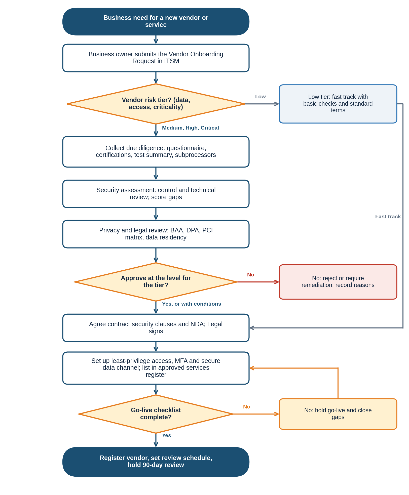

# NexusGuard Technologies Ltd. | Third-Party Vendor Security Onboarding | SOP-D-001

# 1. Document Header

| Field | Detail |
|---|---|
| **SOP ID** | SOP-D-001 |
| **Title** | Third-Party Vendor Security Onboarding |
| **Version** | 1.0 |
| **Effective Date** | Upon approval |
| **Owner** | CISO, with the Procurement Lead |
| **Approved By** | Chief Information Security Officer (approval pending) |
| **Review Date** | 12 months from the effective date |
| **Classification** | Internal |
| **Author** | Augustine Ozor, GRC Analyst |

# 2. Purpose

This SOP makes sure that no vendor receives NexusGuard or client data, system access or a place in the supply chain until its security has been assessed, the right contract terms are agreed, and the risk has been approved at the right level.

It exists because NexusGuard clients and auditors expect proof that suppliers are chosen with security in mind, and because a weak vendor can expose PHI, card data and personal data that NexusGuard is trusted to protect.

# 3. Scope

| Dimension | Coverage |
|---|---|
| Covers | Every new vendor, supplier, contractor firm, cloud or software-as-a-service provider and partner that will process NexusGuard or client data, connect to NexusGuard systems, or supply a service that NexusGuard relies on, from request to go-live and the first 90 days. |
| Includes | PayStream Analytics vendors inherited in the acquisition, free tools used for business, and renewals where the service or data changes. |
| People | Business owners, Procurement, IT, Security, the DPO, Legal and the vendor. |
| Out of scope | Ongoing monitoring and offboarding in detail (a separate procedure), and individual contractors hired as staff (handled by HR and the Access Control Policy). |

# 4. Definitions

| Term | Definition |
|---|---|
| Vendor | Any external organization that supplies goods or services to NexusGuard, including cloud and SaaS providers. |
| Vendor risk tier | The rating (Critical, High, Medium or Low) that sets how much due diligence, approval and monitoring is needed. |
| Due diligence | Evidence gathering and checks on the vendor's security, privacy, legal and financial standing. |
| BAA | Business Associate Agreement: the HIPAA contract needed before a vendor handles PHI for NexusGuard. |
| DPA | Data processing agreement: the contract required under GDPR (Article 28) when a vendor processes personal data. |
| AOC | Attestation of Compliance: the PCI DSS document showing a provider's compliance status. |
| Subprocessor | A further organization used by the vendor that may handle NexusGuard data. |
| Business owner (sponsor) | The NexusGuard manager who needs the service and is accountable for the vendor relationship. |
| Go-live gate | The final check that all required steps are complete before data or access is given. |
| Third-Party Register | The list of all vendors with their tier, owner, contract dates and review dates. |

# 5. Roles and Responsibilities

| Role | Responsibilities in this SOP |
|---|---|
| Business owner (Business Unit Lead) | Raises the request, supplies requirements, acts as sponsor, and stays accountable for the vendor. |
| Procurement Lead and Vendor Management | Run the process, collect evidence, handle commercial terms and keep the Third-Party Register. |
| GRC Analyst | Tiers the vendor, compiles the risk assessment and maintains the evidence. |
| IT Security Manager | Reviews technical controls, architecture, access and integration. |
| DPO | Reviews data processing roles, the need for a DPIA, transfers and data residency. |
| Legal | Reviews and signs contracts, BAAs and DPAs. |
| Compliance Officer | Checks HIPAA, PCI DSS and other regulatory duties. |
| CISO | Approves High-tier vendors, and Critical-tier vendors with Executive Leadership. |
| IT Operations | Set up access, integrations and logging. |
| Vendor | Provides accurate information and evidence, and signs the security terms. |

# 6. Procedure Steps

## 6.1 Triggers and Inputs

- A business owner wants to buy or start using a new vendor, service or tool.
- A vendor is added through an acquisition (for example PayStream Analytics).
- A renewal in which the service, data, access or location changes.
- Discovery of an unapproved vendor or tool in use, which is treated as onboarding with data flows stopped.

## 6.2 Tiering, Evidence and Approval Rules

**Table 1: Vendor Risk Tiers**

| Tier | Criteria | Evidence required | Approver |
|---|---|---|---|
| Critical | Handles PHI, cardholder data or large volumes of personal data; privileged access to production; or an essential service with no substitute | Full questionnaire; ISO 27001 or SOC 2 Type II; PCI AOC and HIPAA attestation where relevant; penetration test summary; BCP and DR evidence; technical review; contract and BAA or DPA | CISO and Executive Leadership; Risk Committee informed |
| High | Handles Confidential data or has network or system access | Full questionnaire; certification or equivalent evidence; technical review; contract with security terms | CISO |
| Medium | Handles Internal data; limited access | Short questionnaire; certifications if available; standard security terms | CISO delegate (IT Security Manager) |
| Low | No data and no access; low spend and easily replaced | Basic checks; standard terms | Procurement Lead and business owner |

**Table 2: Baseline Security Requirements for Vendors**

- Multi-factor authentication for administrative access, and single sign-on with NexusGuard where supported.
- Encryption of NexusGuard data in transit (TLS 1.2 or higher) and at rest.
- Logging of access to NexusGuard data, with logs available on request.
- Vulnerability management and timely patching.
- Notification of a security incident affecting NexusGuard data within 72 hours, or sooner where a client contract requires.
- A current list of subprocessors, with the same obligations passed down.
- Return or secure destruction of NexusGuard data when the contract ends, with a certificate.
- Data held only in the regions agreed with NexusGuard, in line with the Data Classification and Handling Policy.

**Table 3: Go-Live Checklist**

| Check | Confirmed by |
|---|---|
| Risk assessment approved at the right level, with conditions recorded | GRC Analyst |
| Contract with security terms signed; BAA, DPA or PCI responsibility matrix in place where needed | Legal |
| Data classification and data flows confirmed; residency checked | DPO |
| Access set up with least privilege, MFA, a named sponsor and an end date | IT Security Manager |
| Secure data transfer channel and logging in place | IT Operations |
| Incident contacts exchanged | Procurement Lead |
| Vendor entered in the Third-Party Register and the approved services register | GRC Analyst |

## 6.3 Procedure

No data, access or production use is allowed until step 9 is complete. Decision points are in the fourth column and the diagram in Section 7.

| # | Step and action | Role | Decision or condition | Record or output |
|---|---|---|---|---|
| 1 | The business owner submits a Vendor Onboarding Request in ITSM: the service, why it is needed, the data and access involved, volumes, locations, alternatives considered and the expected start date. No data is shared and no commitment is made until the process is complete. | Business owner | Request incomplete: return to the business owner | Request ticket |
| 2 | Tier the vendor using Table 1. GRC and Procurement agree the tier and record the reasons. Check whether the vendor is already in the Third-Party Register. | GRC Analyst; Procurement Lead | Low tier: fast track (basic checks, standard terms, then step 7). Others: continue. | Tier and reasons in ticket |
| 3 | Collect due diligence evidence by tier: security questionnaire, certifications (ISO 27001, SOC 2 Type II, PCI AOC, HIPAA attestation), penetration test summary, policies, subprocessor list, business continuity plan, incident history and insurance. Procurement and Legal run financial and legal checks. | Procurement Lead; vendor | Vendor cannot provide a certificate: accept equivalent evidence approved by the IT Security Manager (Section 8) | Evidence pack |
| 4 | Assess security. Compare the evidence with the baseline requirements in Table 2 and score the gaps. For High and Critical vendors add a technical review of the architecture, data flows, authentication, encryption and logging, and test any integration. | IT Security Manager; GRC Analyst | Material gap: list required remediation | Security assessment report |
| 5 | Review privacy and legal needs. The DPO confirms the vendor's role (processor or controller), the need for a data protection impact assessment, transfers and data residency. Legal confirms the BAA (for PHI), DPA (for personal data) and PCI responsibility matrix (for card data). The Compliance Officer checks regulatory duties. | DPO; Legal; Compliance Officer | DPIA needed: complete it before approval | Privacy and legal review notes |
| 6 | Make the risk decision. GRC compiles the vendor risk assessment with the residual risk after conditions. The approver for the tier (Table 1) decides: approve, approve with conditions, or reject. Conditions and remediation dates are recorded. | GRC Analyst; approver | Reject or remediate: record reasons and tell the business owner. Approve: continue. | Signed risk decision |
| 7 | Agree the contract. Legal makes sure it contains the baseline requirements in Table 2, the right to audit, flow-down to subprocessors, termination assistance and the incident duties. An NDA is signed before any information is shared. | Legal; Procurement Lead | Vendor refuses a required term: escalate to the CISO (Section 8) | Signed contract and NDA |
| 8 | Set up access and the secure channel. Create named accounts with least privilege, MFA, a sponsor and an end date of no more than 90 days (renewable), connect through ZTNA or the vendor gateway, set up logging, and use approved encrypted transfer. List the service in the approved services register and add any assets to the Information Asset Register. | IT Operations; IT Security Manager | Integration fails security checks: fix before continuing | Access and integration record |
| 9 | Hold the go-live gate. Check every item in Table 3. Only when all are complete may data be shared or the service used in production. | GRC Analyst; Procurement Lead | Any item missing: hold go-live and close the gap | Signed checklist |
| 10 | Register the vendor in the Third-Party Register with tier, sponsor, service, data, contract dates, assessment date, subprocessors and next review date. | Procurement Lead; GRC Analyst | None | Register entry |
| 11 | Set the monitoring plan by tier: Critical, a full review every year with quarterly check-ins; High, every year; Medium, every two years; Low, at renewal. Track certificate expiry, service and security performance, and incident notices. | GRC Analyst; business owner | None | Monitoring plan |
| 12 | Tell the people who will use the service what is approved and what is not, including data limits. Make sure vendor staff with access acknowledge the NexusGuard security requirements. | Business owner; IT Security Manager | None | Communication and acknowledgments |
| 13 | Hold a 90-day post-onboarding review: controls working, access used appropriately, remediation on track, no incidents or complaints. Close the onboarding ticket. | GRC Analyst; business owner | Issues found: set actions and re-review in 30 days | Review record; closed ticket |

# 7. Process Flow Diagram

_The diagram follows steps 1 to 13. Decision points: the vendor tier (step 2), approval at the right level (step 6) and the go-live checklist (step 9)._

# 8. Exception Handling

Where the normal procedure cannot be followed, use the fallback below, tell the process owner, and record the deviation in the ticket. Deviations are reviewed with the process results. A lasting deviation from a policy requirement is not an operational exception: it needs a formal exception through the Policy Exception Management Process (PRC-GRC-001).

| Situation | What to do |
|---|---|
| Urgent business need | The CISO may approve limited use for up to 30 days, with no regulated data and no privileged access. The full process shall be completed within that time, or use stops. |
| Vendor refuses a required security term | Escalate to the CISO. Options are compensating controls, a narrower scope, or rejection. A High or Critical vendor needs Executive Leadership approval to proceed. |
| Vendor has no certification | Accept equivalent evidence: a recent independent assessment, a penetration test report and a completed questionnaire, approved by the IT Security Manager. |
| Sole-source vendor | Proceed with conditions and a remediation plan with dates, and record the dependency risk in the Risk Register. |
| Vendor already in use (including PayStream vendors) | Run the process within 90 days, and stop sending regulated data until it is complete. |
| Free or consumer tool found in use | Stop the data flow, treat it as a new request, and decide to approve or remove. |
| Vendor changes ownership, location or subprocessors | Repeat the relevant steps (3 to 6) and update the register. |

# 9. Related Documents

| Document | ID | Relationship |
|---|---|---|
| Information Security Policy (clause 5.11) | POL-ISP-001 | Parent policy; third-party security requirements |
| Third-Party Security Policy | POL-TPS-001 | Detailed supplier requirements |
| Access Control Policy (clause 5.6) | POL-ACC-001 | Third-party and contractor access rules |
| Data Classification and Handling Policy (clause 5.8) | POL-DCH-001 | Data residency and cross-border transfers |
| Acceptable Use Policy (clause 5.6) | POL-AUP-001 | Approved services and shadow IT |
| Policy Exception Management Process | PRC-GRC-001 | Formal exceptions |
| SOP-B Security Incident Classification and Escalation | SOP-B-001 | Vendor incident notifications |
| SOP-C Vulnerability Scanning and Patch Management | SOP-C-001 | Vendor patch duties |
| Forms: Vendor Onboarding Request, Security Questionnaire, Vendor Risk Assessment, Go-Live Checklist | To be issued | Used in steps 1, 3, 6 and 9 |

_Document IDs are proposed identifiers under the policy framework. Confirm them against the document register._

# 10. ISO/IEC 27001:2022 Control Mapping

| Control | Title | How this SOP satisfies it |
|---|---|---|
| A.5.19 | Information security in supplier relationships | Tiering, due diligence, assessment and approval before any data or access (steps 2 to 6). |
| A.5.20 | Addressing information security within supplier agreements | Baseline security terms, NDA, BAA, DPA and audit rights in the contract (step 7, Table 2). |
| A.5.21 | Managing information security in the ICT supply chain | Subprocessor list and flow-down of requirements (steps 3 and 7). |
| A.5.22 | Monitoring, review and change management of supplier services | Register, monitoring plan, 90-day review and change triggers (steps 10, 11 and 13). |
| A.5.23 | Information security for use of cloud services | Cloud and SaaS providers follow the same tiers and checks (steps 2 to 9). |
| A.5.18 | Access rights | Named, least-privilege, time-limited vendor accounts with MFA (step 8). |
| A.5.31 and A.5.34 | Legal and contractual requirements; privacy and protection of PII | BAA, DPA, PCI matrix, DPIA and residency checks (step 5). |

_Control references are to Annex A of ISO/IEC 27001:2022. They are paraphrased pointers; verify them against the source text._

# 11. Document History

| Version | Date | Author | Change | Approved by |
|---|---|---|---|---|
| 0.1 | 19/10/2026 | Augustine Ozor, GRC Analyst | First draft for the ISO 27001:2022 certification audit evidence pack | n/a |
| 1.0 | Pending | Augustine Ozor, GRC Analyst | Approved and issued | CISO (pending) |
